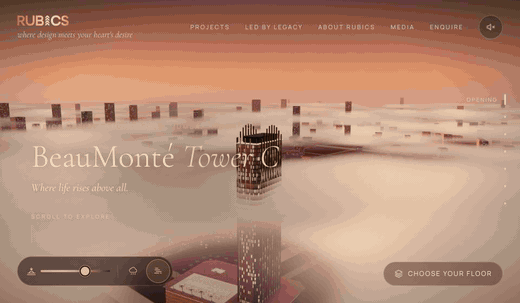

# Rubics 3D: BeauMonté Tower C

**Live:** https://rubics-3d.vercel.app

A real-time 3D rebuild of [rubicsrealty.com](https://rubicsrealty.com) around BeauMonté Tower C, Sion. You never leave the 3D world. The tower, city, sea, sky and clouds are all built in code and rendered live, and the site's content sits on frosted-glass panels over the canvas.



## Try these

| | |
|---|---|
| **Scroll** | The camera rises through the clouds, circles the tower, glides up the facade, drops to the Level 6 deck and pulls back. Scroll up and it replays the same path in reverse. |
| **Time of day** | Drag the slider (bottom left) from sunrise to day to sunset to night. Rain and fog are separate toggles that work at any time of day. |
| **Choose your floor** | Use the picker, or hover over the tower and click a floor. The camera flies up the facade and steps through the glass, so you stand on that floor looking west. Drag (or swipe, or tilt an Android phone) to look around. |
| **View the pool** | From the amenities panel, or by picking Level 6. |
| **Sound** | The speaker button (top right) plays ambient sound generated in the browser: wind that grows with height, rain, water at the pool, and a city hum at night. It's off by default. |
| **Share a view** | The URL keeps up with what you're looking at, e.g. [`?floor=32&time=sunset`](https://rubics-3d.vercel.app/?floor=32&time=sunset), [`?time=night&weather=monsoon`](https://rubics-3d.vercel.app/?time=night&weather=monsoon), or [`?view=pool`](https://rubics-3d.vercel.app/?view=pool). |

## Decisions

- **No invented facts.** Every name, number and line of copy comes from [`src/content.ts`](src/content.ts), taken from rubicsrealty.com, /beaumonte.html and /media.html. Things the site doesn't publish, such as prices, carpet areas and which homes are on which floor, aren't shown. The floor view therefore labels itself with what the site does say: the floor's position among the 41 habitable floors, and the site's description of the west or "above" view. The live site's own wording "tinton facades" is kept exactly as published.
- **Procedural instead of downloaded.** The tower, deck, palms, city, sea, sea link, clouds, sky and rain are all built in code with custom shaders. The only files shipped are the logo and the team photos (about 290 KB), so the first view loads fast and nothing waits on large 3D models.
- **One weather state.** Time of day is a position on a 0–1 slider, blended between four looks (sunrise, day, sunset, night). Monsoon and fog are layered on top of that. Every frame, the blend writes into uniform objects that all materials share, so a single control updates the sky, lighting, windows, city lights and sea together.
- **The camera follows a spline, with damping.** Scroll progress picks a point on two Catmull-Rom curves (one for position, one for where the camera looks), and the camera is damped toward that point, so scrolling backwards retraces the same path smoothly. Floor and pool views use GSAP flights and pause the scroll.
- **The page never leaves 3D.** The canvas is fixed behind the page. Panels fade in as glass, then their lines arrive one by one: top-down on the way in, bottom-up on the way back. The glass gets darker as the scene gets brighter, so text stays readable at noon.

## Performance

- **Two quality tiers.** A device is treated as low tier if it has 4 or fewer CPU cores, 4 GB or less of memory, or a screen narrower than 768 px. The tier also drops if frame rates keep falling. Low tier draws half as many city buildings, uses lighter cloud and sea detail, and skips bloom and film grain. The code for bloom and grain isn't downloaded at all on low-tier devices. Low tier also uses a lighter glass blur.
- **Dynamic resolution.** drei's `PerformanceMonitor` lowers the rendering resolution in steps when frames start taking too long.
- **Built for speed.** Repeated objects are drawn in single batches, there are no real-time shadows (the darkening at the tower's base is painted into the deck's shader), and fades driven by scroll update styles directly instead of re-rendering React.
- **Tested in headless Chrome** at 1440×900, 390×844 and 360×800, with the CPU slowed 4× for the phone sizes. Opening, a full scroll through the journey, and a floor flight all ran at 60 fps with no frames over 17 ms. A 30-step click-through covering every control, link, tab, form state and pop-up passes at all three sizes. These runs used a Mac's GPU, so a real mid-range phone is still the true test.
- **Fallbacks.** Without WebGL, the page shows a still image of the tower and all content still works. `prefers-reduced-motion` shortens camera flights, removes the idle drift and calms the smooth scrolling. The loader always finishes within 12 seconds.

## Stack

Next.js 16 (App Router) · TypeScript · three.js · @react-three/fiber · drei · postprocessing · GSAP · Lenis · zustand · Tailwind CSS 4 · deployed on Vercel.

```
src/
  content.ts          all copy and facts (single source of truth)
  store.ts            scroll progress, mode, time, weather, floor, tier
  ambience.ts         Web Audio ambient sound
  scene/              Experience, CameraRig, Tower, FloorInterior, TowerPicker, AmenityDeck,
                      City, Sea, Sky, Clouds, Rain, SeaLink, weather + presets, Effects
  ui/                 Loader, Brand, ScrollPanels, JourneyDots, WeatherControl, FloorPicker,
                      AmenityControl, SoundToggle, UrlState, sections/
```

## Run locally

```bash
npm install
npm run dev
```

Add `?debug` to the URL to see scroll progress and the camera's position, which helps when adjusting [`src/scene/cameraPath.ts`](src/scene/cameraPath.ts).

The enquiry form is a demo: it validates each field but doesn't send anything, and the page says so under the button.
